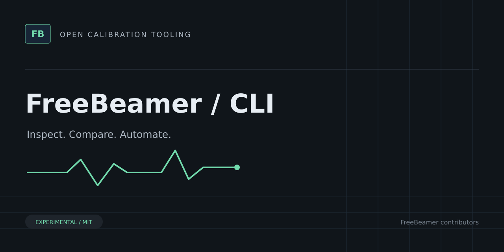

# FreeBeamer CLI



Command-line tools for inspecting calibration files, reviewing binary changes, verifying checksums, and collecting experimental live data.

> [!WARNING]
> Experimental software. Not validated for vehicle use. Do not flash files produced by FreeBeamer.

Includes XDF/A2L import, map inspection and editing, byte diffs, firmware identification, checksum verification/correction for explicitly supported layouts, and experimental MHD monitoring.

```sh
freebeamer xdf info definition.xdf
freebeamer a2l info definition.a2l
freebeamer diff original.bin modified.bin
freebeamer checksum verify original.bin
```

Firmware and definitions are supplied by the operator and are not bundled.

## Development

```sh
go test ./...
go build -o bin/freebeamer ./cmd/freebeamer
./bin/freebeamer --help
```

## Related projects

- [Core](https://github.com/freebeamer/core) — Go libraries for ECU calibration formats, binary editing, checksums, vehicle profiles, and telemetry contracts.
- [Desktop](https://github.com/freebeamer/desktop) — Experimental ECU calibration editor and live-data viewer built with Go, Wails, Angular, and Plotly.
- [Relay](https://github.com/freebeamer/relay) — Self-hosted Go telemetry relay with authenticated ingestion, SQLite storage, session history, and WebSocket live feeds.
- [Mobile](https://github.com/freebeamer/mobile) — Experimental Flutter companion for read-only MHD/ENET live-data acquisition and upload to a FreeBeamer telemetry relay.

## Contributing and license

See [CONTRIBUTING.md](CONTRIBUTING.md). Source and original artwork are licensed under [MIT](LICENSE). Do not submit proprietary firmware, customer files, secrets, or identifying vehicle data.
